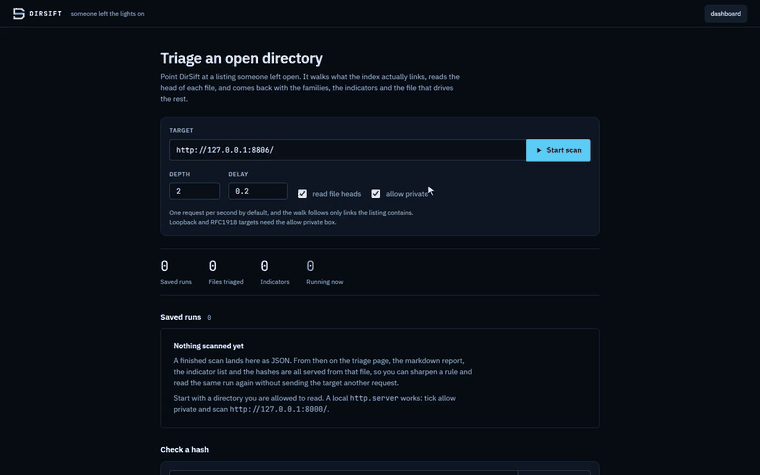

# DirSift

[](https://github.com/cyb3rp03t/dirsift/actions/workflows/ci.yml)

**Triage an open directory: walk it, classify what is there, find the file that
drives the rest, and write the notes.**

You find an open directory. Forty files, half of them named like a build number,
a batch file somewhere, and no way to know what matters without opening every
one of them. DirSift does the mechanical part of that first pass and hands you a
markdown page you can argue with.

It does not decide anything for you. It collects.

```
██████╗  ██╗ ██████╗  ███████╗ ██╗ ███████╗ ████████╗
██╔══██╗ ██║ ██╔══██╗ ██╔════╝ ██║ ██╔════╝ ╚══██╔══╝
██║  ██║ ██║ ██████╔╝ ███████╗ ██║ █████╗      ██║
██║  ██║ ██║ ██╔══██╗ ╚════██║ ██║ ██╔══╝      ██║
██████╔╝ ██║ ██║  ██║ ███████║ ██║ ██║         ██║
╚═════╝  ╚═╝ ╚═╝  ╚═╝ ╚══════╝ ╚═╝ ╚═╝         ╚═╝
 s o m e o n e   l e f t   t h e   l i g h t s   o n
                   by cyb3rp03t
```



## What it does

- **Walks the index.** Apache, nginx, IIS, Python `http.server`, Caddy, lighttpd,
  h5ai and JSON autoindex, breadth-first, bounded on depth, entries, requests and
  bytes.
- **Classifies by magic bytes, not by name.** It reads the first few kilobytes of
  each file, so `invoice.pdf` that starts with `MZ` shows up as the type mismatch
  it is. That row is usually the reason the directory was worth looking at.
- **Collapses version families.** `secrun2.exe` through `secrun6.exe` is one
  artefact with five builds. Gaps stay visible: a jump from 4 to 6 means a build
  was pulled.
- **Guesses the entry point.** The file that names the other files, contains
  command-shaped strings and sits at the top of the tree is ranked first, with
  the reasons shown. It is a candidate, not a verdict.
- **Extracts indicators.** Addresses, URLs, domains, credential shapes, mutexes,
  registry keys and paths, each with the line it came from, deduped across
  defanged and live spellings, and defanged on the way out.
- **Hashes what it read whole.** sha256 and md5 for every file that fitted under
  the peek ceiling, in the listing, in the report and in `hashes.txt`. A file cut
  at the ceiling gets no hash and says so, because half a file hashes to nothing
  anyone can look up.
- **Asks about a hash, when you ask it to.** One button, one file: the digest
  goes to VirusTotal and comes back as a score like `6/64`. The sample is never
  uploaded and nothing is sent until you press it.
- **Writes YARA rules from what it read.** Tick the files, get one rule each,
  keyed to the indicators that file carried rather than to its digest. The hash
  stays in meta as identity: a hash matches one build, the address inside it
  usually survives the next one.
- **Writes the page.** A markdown triage report, plus a scaffold for the writeup
  that is left empty on purpose.

## Rules of engagement

DirSift points at infrastructure that belongs to someone else. The limits are in
the code rather than in this file, and there are tests that fail if they break:

- **GET and HEAD only.** No other method is reachable from the fetcher.
- **No path guessing.** Every URL requested was linked from a listing DirSift
  already parsed. There is no wordlist and no `/admin` probe. Reading what a
  server volunteers is a different act from discovering what it does not.
- **No credentials, ever.** A 401 ends that branch of the walk.
- **Stay under the root.** Off-host links, scheme downgrades and parent links are
  recorded and not followed.
- **Slow on purpose.** One request per second by default, `Retry-After` honoured.
  The delay can be raised but not dropped to zero.
- **Bounded reads.** File bodies are streamed and cut at a ceiling. DirSift wants
  the first bytes for a magic check, not the payload.
- **Nothing leaves unless you send it.** The scan itself talks to the target and
  to nothing else: no lookups, no enrichment, no submissions. The single
  exception is the hash check, which is a button you press for one file at a
  time, sends a digest and never a sample, and does nothing at all without an
  API key. Enrichment leaks what you are looking at, so it stays a decision you
  make rather than a default.

The line this draws is the practical one from the Harvard Cyberlaw Clinic's
researcher guidance: read what is served, take nothing that needs a credential,
guess no paths, bypass no controls, write nothing. Downloading a file an open
directory lists is not the same act as brute-forcing directory names, and only
one of them is the category researchers get sued over. This is a tool for the
first, and it cannot be configured into the second.

## Install

Needs Python 3.11 or newer. With [uv](https://github.com/astral-sh/uv):

```bash
git clone https://github.com/cyb3rp03t/dirsift
cd dirsift
uv sync
uv run dirsift --help
```

Or with pip:

```bash
pip install -e .
dirsift --help
```

## Use

```bash
# triage a directory and write the report
dirsift scan http://203.0.113.10:8080/files/ -o triage.md --json run.json

# slower, deeper, quiet
dirsift scan http://203.0.113.10:8080/files/ --depth 4 --delay 3 -q

# through a proxy, because the target does not need your home address
dirsift scan http://203.0.113.10:8080/files/ --proxy socks5://127.0.0.1:9050

# re-render a saved run, offline, without touching the target again
dirsift report run.json -o triage.md

# just the indicators, for piping
dirsift iocs run.json --type ipv4

# sha256, md5 and path for the files read whole
dirsift hashes run.json

# YARA rules from that run, keyed to the indicators each file carried
dirsift rules run.json --out hunt.yar
dirsift rules run.json --name install.bat

# ask a public scanner about one digest, which is the only call that leaves
dirsift check 13565af72d91125920826dd15db83bd6e48aecc1a466b9a639a6780eaf037342

# the local triage UI
dirsift web
```

Scanning is separate from analysing on purpose. `--json` saves everything the
walk saw; `report` and `iocs` work from that file with no network at all. Sharpen
a rule, re-run the analysis, leave the target alone.

### The console

`dirsift web` serves a local page on `127.0.0.1:8000`. The run page leads with
the target and the numbers that decide whether to keep going, then the ranked
entry points, the inventory, the indicators, and the listing beside a preview
panel, so picking a file never loses the list.

The preview panel is where the reading happens:

- both hashes with a copy button, and how much of the file was actually read
- a warning when the magic bytes disagree with the extension
- the contents, raw and escaped, with the run's indicators marked in place and
  the lines numbered
- the first bytes as hex, for anything binary
- the indicators that came out of this file, the files that name it, and the
  other versions in its family, with a compare button between two of them
- a check button that asks a public scanner about the hash, and an open link
  that hands the same hash to your browser instead, which costs no API key

Tick files in the listing to build a YARA rule from them. `j` and `k` walk the
listing from the keyboard, and the file you opened stays in the address bar, so
a preview can be reloaded or handed to someone else.

Fonts and htmx are vendored into the package, so the console works on an
air-gapped analysis box. It never reaches out on its own: a scan starts when you
press the button, every view after that is served from the saved run, and the
hash check is the one thing that leaves, only when pressed.

## Options that matter

| Option | Default | Why you would change it |
|---|---|---|
| `--depth` | 2 | Deep trees. Costs requests fast. |
| `--delay` | 1.0 | Raise it on a host you do not want to annoy. Floor is 0.2. |
| `--no-peek` | off | Map the tree without reading any file body. |
| `--peek-bytes` | 65536 | Lower for speed, raise for long scripts. |
| `--max-requests` | 600 | The hard stop. |
| `--proxy` | none | Route through Tor or a VPS. |
| `--allow-private` | off | Needed for loopback and RFC1918 targets. |

## What it is not

Not a scanner, not a crawler, not a sandbox, not an enrichment pipeline. It reads
one directory that is already open and tells you what is in it.

Pulling a sample and running it is a separate decision that belongs in an
isolated VM with a snapshot and no route to your host. DirSift never downloads a
full binary and never executes anything.

## Development

```bash
uv sync
uv run pytest          # 120 tests
uv run ruff check .
```

Every push runs the suite on Windows and Linux, against Python 3.11 and 3.13.
That matrix is not decoration: the failures it catches are the ones that never
appear on the machine the code was written on. A console that cannot encode an
attacker's filename, a path separator, a line ending off an IIS box.

The tests that matter most are in `tests/test_rules.py`: they stand up a local
server and assert that only GET is ever sent, that a 401 ends the walk, that no
path is invented, and that the delay cannot be dialled to zero.

## Disclaimer

For research and defensive work. You are responsible for what you point it at:
the law about accessing someone else's server varies by country and is not
settled, and an open directory is not a general licence. If you are not sure
whether you are allowed to look at something, you are not sure.

Samples belong in a VM, never in a repository. `.gitignore` reflects that from
the first commit.

## Licence

Apache-2.0. See [LICENSE](LICENSE).
